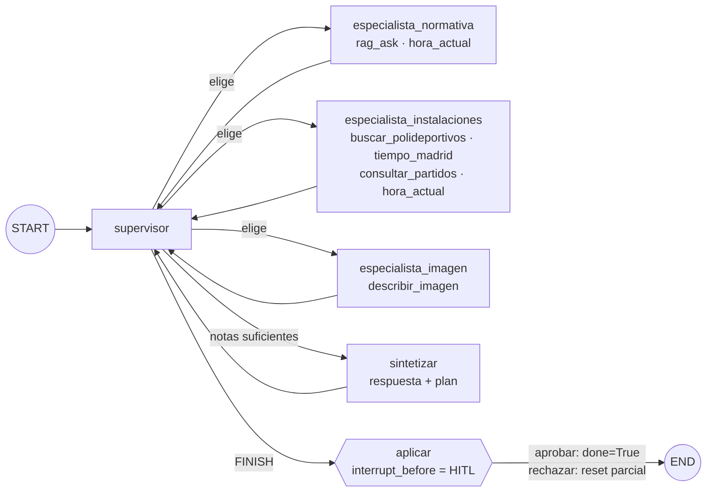
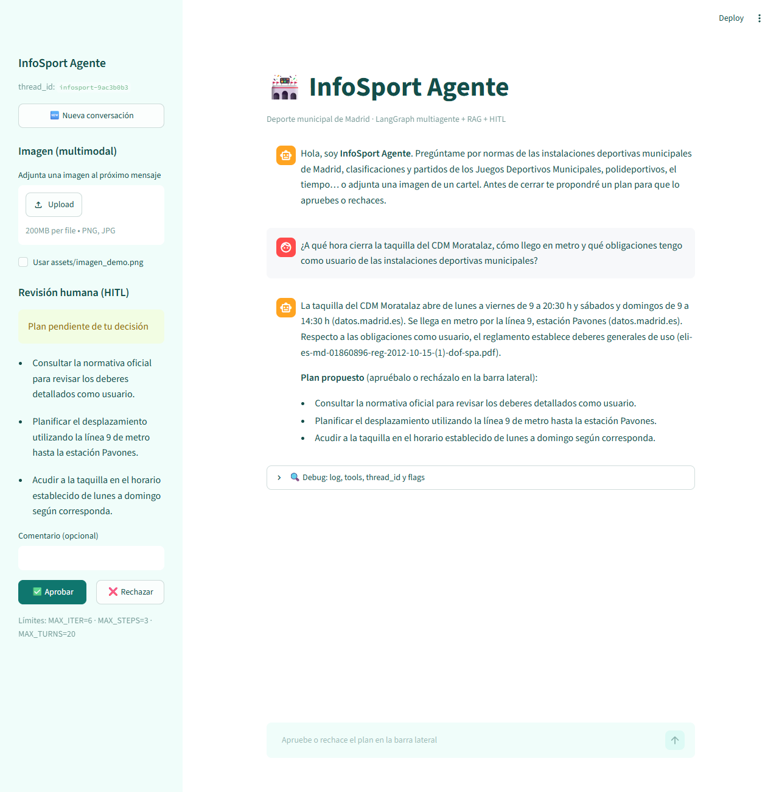
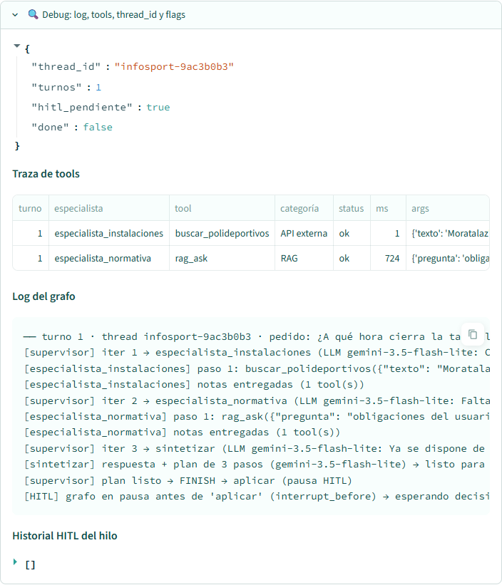
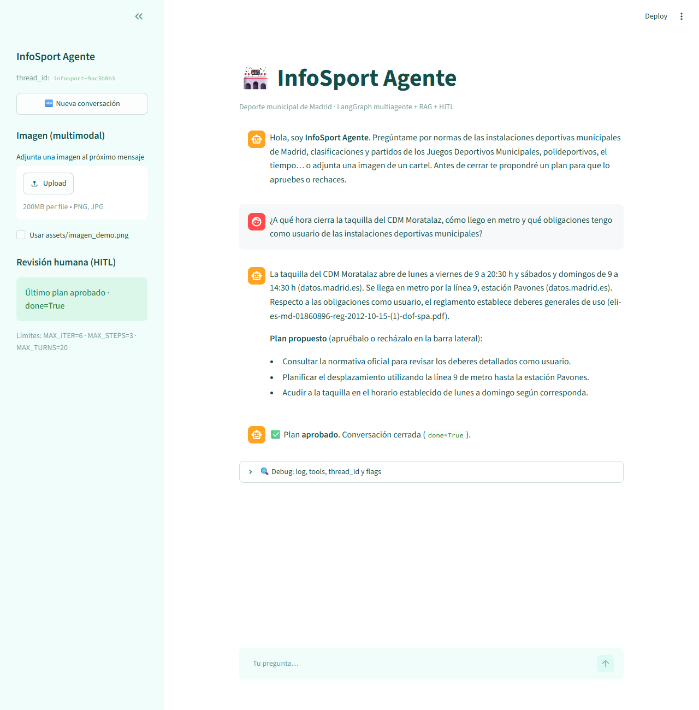
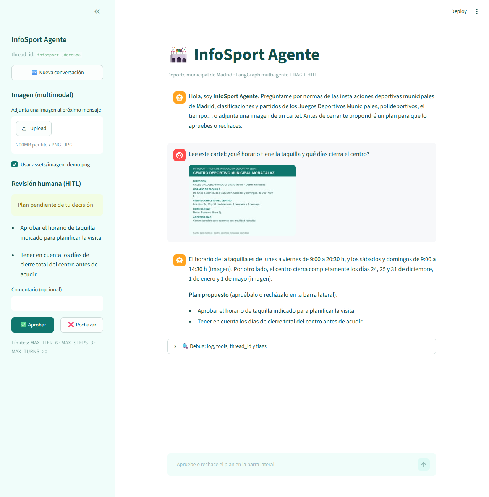
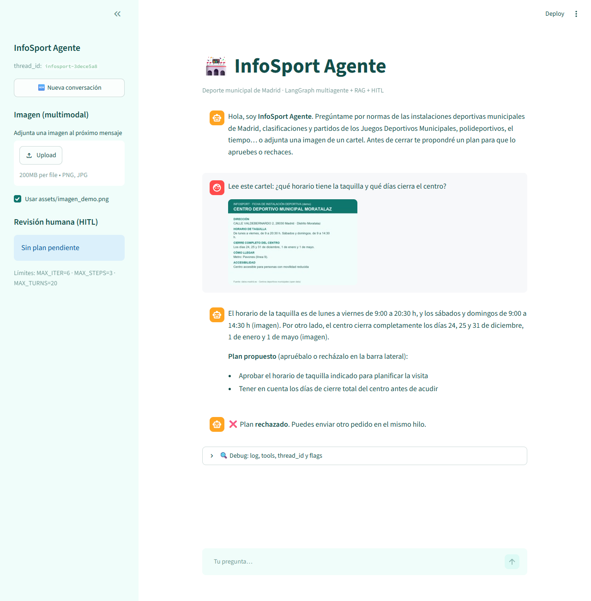

# InfoSport Agente · Project Break 2 (LangGraph)

Asistente **multiagente** sobre el **deporte municipal de Madrid** construido con **LangGraph**.
Un supervisor reparte el trabajo entre tres especialistas que usan tools controladas: el **RAG
completo del Project Break 1** (reglamento de instalaciones deportivas municipales + Juegos Deportivos
Municipales), **APIs abiertas** (polideportivos de datos.madrid.es y tiempo de Open-Meteo), una
herramienta auxiliar de hora y una tool **multimodal** que lee carteles. Antes de cerrar, el agente
propone un plan que un humano **aprueba o rechaza** (HITL). Las conversaciones se guardan con
`MemorySaver` + `thread_id`, y hay dos clientes: **CLI** y **Streamlit**.

> Proyecto individual de Yordanos López Díaz · Bootcamp The Bridge · pieza 2 de 3 (RAG → **Agente** → MLOps).

---

## 1. Dominio, alcance y diseño (Parte 1)

**Tema:** el asistente ayuda a quien usa las instalaciones deportivas municipales de Madrid. Responde
qué normas hay que cumplir, cómo va su equipo en los Juegos Deportivos Municipales, dónde está y
cuándo abre un polideportivo, si hace tiempo para jugar fuera y qué pone en un cartel.

**Origen del RAG:** viene del **PB1** (InfoSport, el mismo corpus), con mejoras documentadas en [specs/01_rag.md](specs/01_rag.md).

| Sí resuelve | No resuelve (se abstiene / lo dice) |
|---|---|
| Normas, derechos, obligaciones y sanciones del Reglamento | Datos que no estén en el corpus ni en las tools (calorías, precios no publicados…) |
| Clasificaciones por grupo 2025/2026 | Reservas o pagos reales: solo **propone** un plan |
| Partidos por equipo, fecha, estado o deporte | Inventar datos si una tool falla |
| Dirección, horario de taquilla y transporte de polideportivos | |
| Tiempo actual en Madrid · fecha y hora | |
| Leer un cartel, panel o folleto (imagen) | |

### Grafo



| Especialista | Responsabilidad | Tools (allowlist) |
|---|---|---|
| `especialista_normativa` | Reglamento, JDM, clasificaciones | `rag_ask`, `hora_actual` |
| `especialista_instalaciones` | Polideportivos, tiempo, partidos | `buscar_polideportivos`, `tiempo_madrid`, `consultar_partidos`, `hora_actual` |
| `especialista_imagen` | Imágenes adjuntas | `describir_imagen` |

**Límites en Python** ([config.py](config.py)): `MAX_ITER=6` (vueltas del supervisor), `MAX_STEPS=3`
(tools por especialista), `MAX_TURNS=20` (turnos por hilo) y `MAX_MENSAJE=500`. Si el LLM del
supervisor falla o elige algo que no existe, un **fallback determinista** por palabras clave decide
la ruta. `done` solo lo pone a `True` el nodo `aplicar` cuando un humano aprueba.

**Datos:** todos son públicos (datos.madrid.es, sede.madrid.es, Open-Meteo) y el uso es educativo.
El repositorio no contiene secretos: la API key vive en `.env`.

### Spec-Driven Development
Antes de programar cada bloque se escribió su especificación en [specs/](specs/): [visión y contrato](specs/00_vision_y_contrato.md),
[RAG](specs/01_rag.md), [tools](specs/02_tools.md), [grafo y HITL](specs/03_grafo_hitl.md) y [clientes](specs/04_clientes.md).
Esas specs guiaron al asistente de código, y los criterios de aceptación de cada una se comprobaron al final.

---

## 2. Estructura

```
ProjectBreak2_Yordanos/
├── config.py               # límites, modelos, rutas y allowlist por especialista
├── gemini_auth.py          # cliente Gemini (GOOGLE_API_KEY)
├── main.py                 # CLI: prepare/index · rag · tool · demo · chat (HITL)
├── app.py                  # Streamlit (cliente del grafo)
├── rag/                    # RAG completo (PB1): load · chunk · embed · index · retrieve · generate · logic
├── src/
│   ├── state.py            # EstadoProducto (lo que ven CLI / UI)
│   ├── llm.py              # Gemini texto / JSON / visión con fallback de modelos
│   ├── graph.py            # StateGraph multiagente + MemorySaver + interrupt_before
│   ├── agent.py            # procesar_turno · aprobar_plan · get_graph
│   └── tools/              # allowlist + ejecutar_tool + 6 tools
├── scripts/crear_imagen_demo.py
├── data/                   # corpus RAG + fallback/ de las APIs
├── assets/imagen_demo.png  # demo multimodal
├── specs/                  # SDD
├── docs/img/               # capturas del README
├── entregables/            # informe_decisiones.md · presentacion_infosport_agente.pdf · guion_grabacion.md
└── .streamlit/config.toml
```

---

## 3. Instalación

```bash
git clone https://github.com/yordi33/ProjectBreak2_Yordanos.git
cd ProjectBreak2_Yordanos
python -m venv .venv
source .venv/bin/activate        # Windows: .venv\Scripts\activate
pip install -r requirements.txt
cp .env.example .env             # Windows: copy .env.example .env
```

Edita `.env` y pon tu `GOOGLE_API_KEY` (de Google AI Studio). Los modelos se configuran en
`config.GEMINI_MODELS`: se usa el primero disponible y, si da 503/429/404, se pasa al siguiente.

## 4. Indexar el RAG

```bash
python main.py --prepare --index
```

Hace `load → chunk → embed → Chroma`: genera 1.674 chunks en `output/chroma_db` en 1-2 minutos.
Los embeddings se calculan **en local** con `fastembed`
(`paraphrase-multilingual-MiniLM-L12-v2`, multilingüe, 384 dimensiones). El modelo se descarga
una sola vez en `output/modelos/`. También se puede usar `gemini-embedding-001` poniendo
`EMBEDDING_PROVIDER = "gemini"` en `config.py`, pero la cuota gratuita diaria se agota antes de
terminar el corpus (ver el informe). El proceso es **reanudable**: si se corta, solo embebe lo que
falta. La carpeta `output/` no se sube al repo.

Prueba del RAG sin el agente:

```bash
python main.py --rag "¿Qué multa máxima se aplica a las infracciones muy graves?"
```

```bash
python main.py --rag "¿Cuántas calorías quema un adulto en las barcas de recreo?"
```

La primera pregunta está en el corpus: responde con fuentes y chunks. La segunda está fuera del
corpus: devuelve `hay_evidencia=false` (abstención).

## 5. Ejecutar

**Probar las tools aisladas (sin el grafo):**

```bash
python main.py --tool hora_actual
```

```bash
python main.py --tool buscar_polideportivos --args "{\"distrito\": \"Retiro\"}"
```

```bash
python main.py --tool borrar_todo
```

La última sale `bloqueada` por la allowlist.

**Demo guiada de la CLI** (3 pedidos en el mismo `thread_id`, con decisiones HITL automáticas: aprobar, rechazar y aprobar):

```bash
python main.py --demo --auto
```

**CLI interactiva con HITL manual** (comandos: `/imagen` para adjuntar la imagen demo, `/nueva`, `/historial`, `/salir`):

```bash
python main.py --chat
```

**Streamlit:**

```bash
streamlit run app.py
```

## 6. Cómo probar el HITL y el multimodal

1. Pide algo, por ejemplo: *«¿A qué hora cierra la taquilla del CDM La Elipa y hace buen tiempo hoy para correr?»*.
2. El log muestra `supervisor → especialista_instalaciones → buscar_polideportivos, tiempo_madrid → sintetizar → FINISH`, y el grafo **se pausa** antes de `aplicar`.
3. **Aprobar**: `done=True` y queda en el historial del hilo. **Rechazar**: el plan se descarta (`done=False`) y puedes enviar otro pedido en el mismo `thread_id`.
4. **Multimodal**: en Streamlit marca «Usar assets/imagen_demo.png» o sube una imagen. En la CLI escribe `/imagen`. Después pregunta *«Lee este cartel: ¿qué días cierra el centro?»*. El supervisor envía el pedido a `especialista_imagen` → `describir_imagen`.
5. El expander **Debug** muestra los flags (`thread_id`, `hitl_pendiente`, `done`), la tabla de trazas de tools, el log del grafo y el historial HITL.

### Capturas

**Pedido mixto → dos especialistas → plan en pausa HITL.** El chat se bloquea hasta que apruebas o rechazas en la barra lateral.



**Debug:** flags del hilo, traza de tools (especialista, tool, categoría, status, ms, args), log del grafo e historial HITL.



**Aprobar** → `done=True`.



**Multimodal:** con «Usar assets/imagen_demo.png» marcado, el supervisor envía el pedido a `especialista_imagen` → `describir_imagen`.



**Rechazar** → el plan se descarta (`done=False`) y el chat vuelve a aceptar pedidos en el mismo `thread_id`.



**CLI** (`python main.py --demo --auto`, extracto real):

```text
── turno 1 · thread infosport-b1ccdf9e · pedido: Quiero ir a nadar al Centro Deportivo Municipal Moratalaz…
[supervisor] iter 1 → especialista_instalaciones (LLM gemini-3.5-flash-lite: Necesitamos consultar los horarios de taquilla…)
[especialista_instalaciones] paso 1: buscar_polideportivos({"texto": "Moratalaz", "distrito": "Moratalaz", "max_resultados": 1}) → ok (1047 ms)
[supervisor] iter 2 → especialista_normativa (LLM gemini-3.5-flash-lite: Falta consultar las normas del reglamento…)
[especialista_normativa] paso 1: rag_ask({"pregunta": "…normas de uso para natacion"}) → ok (4535 ms)
[supervisor] iter 3 → sintetizar (LLM gemini-3.5-flash-lite: Tenemos todos los datos necesarios…)
[sintetizar] respuesta + plan de 3 pasos (gemini-3.5-flash-lite) → listo para HITL
[supervisor] plan listo → FINISH → aplicar (pausa HITL)
[HITL] grafo en pausa antes de 'aplicar' (interrupt_before) → esperando decisión humana
🧑 HITL (auto): APROBAR
  flags: {'thread_id': 'infosport-b1ccdf9e', 'turnos': 1, 'hitl_pendiente': False, 'done': True}
```

## 7. Tools

| Tool | Tipo | Fuente | Fallback |
|---|---|---|---|
| `rag_ask` | RAG completo | `rag.responder()` → Chroma + Gemini | error en traza |
| `buscar_polideportivos` | API externa | [datos.madrid.es · polideportivos](https://datos.madrid.es/egob/catalogo/200186-0-polideportivos.json) | `data/fallback/polideportivos.json` |
| `tiempo_madrid` | API externa | [Open-Meteo](https://open-meteo.com/) | `data/fallback/tiempo_madrid.json` (marcado «NO actuales») |
| `consultar_partidos` | datos estructurados (extra) | CSV de partidos con pandas | — |
| `hora_actual` | auxiliar | `datetime` Europe/Madrid | — |
| `describir_imagen` | multimodal | Gemini visión (solo `assets/` y `output/uploads/`) | — |

**Cómo se conecta el RAG:** `src/tools/rag_ask.py` envuelve `rag.responder(pregunta)` con `@tool`
de LangChain. El especialista propone `{"tool": "rag_ask", "args": {...}}` y `ejecutar_tool`
comprueba la allowlist, ejecuta la tool y deja la traza (nombre, args, status, ms y preview).

## 8. Corpus del RAG (fuentes)

| Archivo | Formato | Fuente | Descarga |
|---|---|---|---|
| `eli-es-md-01860896-reg-2012-10-15-(1)-dof-spa.pdf` | PDF (25 págs.) | [Reglamento de instalaciones deportivas municipales](https://sede.madrid.es/eli/es-md-01860896/reg/2012/10/15/(1)/dof/spa/pdf) | 2026-09-16 (PB1) |
| `211549-2-clasificacion-csv.csv` | CSV (8.769 filas → 1.557 grupos) | [Competiciones municipales temporada vigente](https://datos.madrid.es/dataset/211549-0-juegos-deportivos-actual) | 2026-10-10 (PB1) |
| `211549-0-partidos-csv.csv` | CSV (28.743 filas, tool estructurada) | ídem | 2026-10-10 (PB1) |
| `211549-4/5-juegos-deportivos-actual.pdf` | PDF | Descripción de campos de partidos y clasificación (ídem) | 2026-09-16 (PB1) |
| `fallback/polideportivos.json` | JSON | API datos.madrid.es | 2026-11-02 |
| `fallback/tiempo_madrid.json` | JSON | API Open-Meteo | 2026-11-02 |

`assets/imagen_demo.png` se genera con [scripts/crear_imagen_demo.py](scripts/crear_imagen_demo.py) a partir de los datos abiertos
del CDM Moratalaz. Es una ficha propia de demo, no un cartel oficial.

## 9. Extras

- **SqliteSaver**: pon `CHECKPOINTER = "sqlite"` en `config.py` y los checkpoints se guardan en `output/checkpoints.sqlite`, así sobreviven a reinicios del proceso.
- Una cuarta tool de datos estructurados (`consultar_partidos`) y una segunda API (`tiempo_madrid`).
- El modelo cambia solo a otro si el primero está saturado (503).
- SDD en [specs/](specs/).

## 10. Solución de problemas (Windows)

| Síntoma | Causa | Solución |
|---|---|---|
| `Windows fatal exception: access violation` en `chromadb` o `DLL load failed` en `onnxruntime` | Runtime de Visual C++ antiguo (< 14.40) | Instalar el redistribuible oficial: `winget install Microsoft.VCRedist.2015+.x64` |
| `CERTIFICATE_VERIFY_FAILED` al llamar a Gemini | Python no usa los certificados del sistema | Ya resuelto con `truststore` (en `requirements.txt`) |
| `503 UNAVAILABLE` del modelo | Saturación de Gemini | `src/llm.py` reintenta y pasa al siguiente modelo de `GEMINI_MODELS` |

## 11. Git

El repo tiene las ramas `main` (estable), `develop` (integración) y una rama `feature/*` por bloque
de trabajo, que se integra en `develop` con merge `--no-ff`. Es un proyecto individual: no hay
revisión de PRs entre compañeros.
